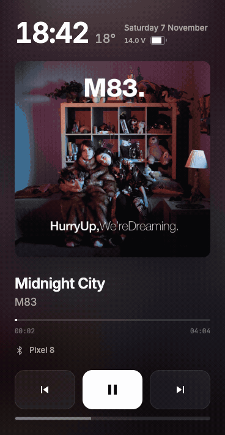
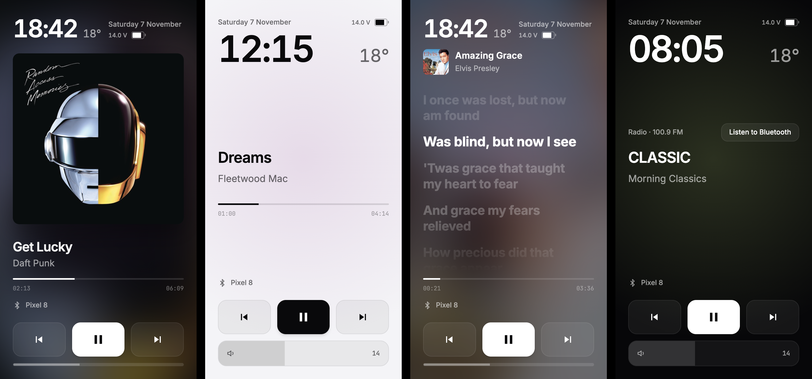

# Dashphonic

A Bluetooth music panel and clock for FYT head units. Dashphonic is designed to work well in a side panel.

[Русская версия](README.ru.md)

<p align="center"></p>



## Why it exists

On FYT firmware the Bluetooth player lives inside the system service `com.syu.ms` and does not publish an Android `MediaSession`. Widgets and players from Google Play see nothing while music plays from the phone. Dashphonic talks to that service over its AIDL interface (`com.syu.ipc.IRemoteToolkit`) and listens to the firmware broadcasts, so it gets the track title, artist, position and volume directly.

## Features

- Track title, artist and progress from the phone, with play, pause and track controls
- Gestures: swipe left or right to change track, double-tap to pause, slide the bottom bar or drag two fingers up and down for volume
- Album art (iTunes Search, then MusicBrainz and Cover Art Archive) and synced lyrics (LRCLIB). Both can be turned off, and then the app makes no requests for them
- Bluetooth: connect a paired phone, search for new devices, give devices your own names
- Clock, date, outside temperature from Open-Meteo, phone battery level
- Car voltage with a chart for the current trip
- Light and dark themes, switched by headlights or by time, a quiet Zen mode, a choice of fonts, Russian and English
- Updates from GitHub Releases inside the app

## Supported devices

Built and tested on an Ekiy T7 (FYT UIS7862, Android 10). Other FYT head units on UIS7862 or UIS8581 with the `com.syu.ms` service should work too. If you try it on another model, please open an issue and say what works.

The app id is `com.ava.car`. FYT firmware sends media broadcasts only to a whitelist of packages, and this id is on it. Because of that, Dashphonic cannot be installed next to another app that already uses `com.ava.car`.

## Install

1. Download `dashphonic-X.Y.Z.apk` from [Releases](../../releases/latest).
2. Copy it to a USB stick or open the link in the head unit browser, then install it. Android will ask to allow installs from that source.
3. Open Dashphonic on its own or in a split-screen panel.
4. A short tutorial runs on first launch. You can run it again from Settings → How to use.

Later updates arrive in the app: Settings → App shows the installed version and installs a new one. Automatic checks run at most twice a day and can be turned off.

If a previous build has a different signing key or a higher Android version code, Android will require you to uninstall it before installing this release. Uninstalling removes the app’s local settings and history.

## Using Dashphonic

Swipe left or right to change tracks and double-tap to pause. Adjust volume with two fingers or the bar at the bottom. Tap the voltage reading, when available, to open the current trip chart. Tap the clock for settings.

## Privacy

Dashphonic has no accounts, analytics or ads. Settings, trip voltage history and cached covers and lyrics stay on the head unit, and Android backup is disabled.

The app makes network requests only for features you use:

| Feature | Service | What is sent |
| --- | --- | --- |
| Album art | itunes.apple.com, mzstatic.com, musicbrainz.org, coverartarchive.org, archive.org | artist and track title |
| Lyrics | lrclib.net | artist, track title, duration |
| Weather | open-meteo.com | coordinates or the city you typed |
| Updates | api.github.com, github.com | nothing beyond a normal request |

Location permission is requested only when you choose current location for the weather.

## Build

GitHub Actions builds a debug APK on every push and pull request (`.github/workflows/build.yml`). To build locally you need JDK 17, the Android SDK with API 34 and Gradle 8.2:

```bash
gradle :app:assembleDebug
```

The panel is a single page, `app/src/main/assets/panel.html`. Open it in a browser through any static server to work on the interface with demo data:

```bash
python3 -m http.server 8766 --directory app/src/main/assets
```

Tests for the panel logic run on Node:

```bash
node --test tests/*.test.cjs
```

## Releases from your fork

The in-app updater reads releases of the repository the APK was built from, so a fork updates from itself.

1. Create a signing key and add it to the repository secrets. The script prints the `gh secret set` commands:

   ```bash
   scripts/create-release-key.sh
   ```

2. Push a tag:

   ```bash
   git tag v1.0.0 && git push origin v1.0.0
   ```

`.github/workflows/release.yml` builds the signed APK, sets `versionCode` from the tag (v1.2.3 becomes 10203) and publishes the release. Keep a backup of the key: an APK signed with a different key will not install over the existing app.

## License

MIT, see [LICENSE](LICENSE). Bundled fonts are under the SIL Open Font License, the license files are next to them in `app/src/main/assets/fonts`.

## Without an internet connection

The interface, clock, Bluetooth controls, track information received from the head unit, and trip voltage history work without internet. Weather uses the last cached reading, marked as stale. New artwork, lyrics, weather readings and release checks need a connection; a track may also have no artwork or synced lyrics even when online. Zen mode does not request artwork or lyrics.

## Contributing

Issues and pull requests are welcome. Include your head unit model, Android and firmware versions, steps to reproduce, and expected and actual behavior. Remove device identifiers and private information from logs or screenshots before posting.

For a change, fork the repository, create a branch, run the Node tests and build the debug APK. Describe the change and how you tested it in the pull request. FYT integration depends on firmware; if you test on hardware, include the model and firmware version. Keep changes focused and avoid committing signing keys or generated APKs.

The launcher icon is based on the supplied Dashphonic artwork. The rest of the project is licensed as described below.
