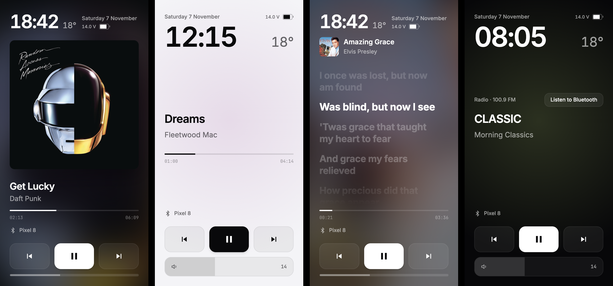
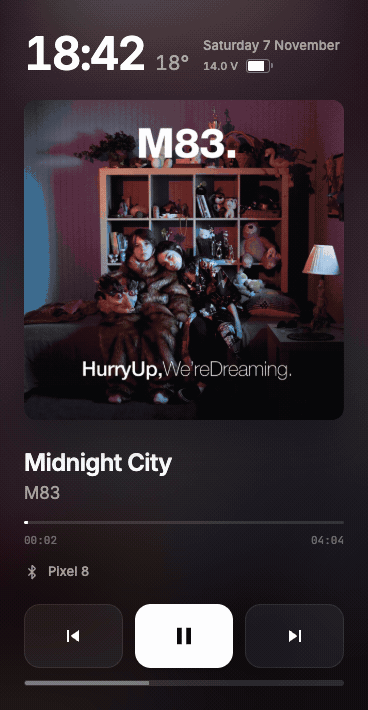

# Dashphonic

Панель с Bluetooth-плеером и часами для Android-магнитол FYT.

Название трека с телефона, переключение музыки и громкость в узкой боковой панели, рядом с навигацией. Dashphonic получает данные напрямую из прошивки FYT, в том числе о музыке, которую не видят обычные виджеты Android.

**[Скачать APK](https://github.com/vsevalid/dashphonic/releases/latest)** · [Совместимость](#совместимость) · [Установка](#установка) · [English](README.md)



<details>
<summary>Смотреть демо: переключение треков, текст песни и экран поездки</summary>

<p align="center"></p>

</details>

## Возможности

- Название, исполнитель и прогресс трека с телефона, кнопки воспроизведения и управление жестами.
- Обложки и синхронный текст песни с отдельными выключателями. Zen-режим скрывает и то и другое и прекращает запросы за ними в сеть.
- Список Bluetooth-устройств: подключение сопряжённых телефонов, поиск устройств поблизости и свои имена внутри приложения.
- Часы, дата, температура на улице, заряд телефона и график напряжения за текущую поездку. Заряд и напряжение отображаются, если телефон и прошивка передают эти данные.
- Информация о FM-станции и кнопка возврата к Bluetooth.
- Светлая и тёмная темы, переключение по фарам или времени, выбор шрифтов, русский и английский интерфейсы.
- Проверка и установка обновлений из GitHub Releases прямо в приложении.
- Просмотр пика напряжения удержанием, прокрутка длинных поездок и горизонтальный масштаб двумя пальцами. Пауза при заднем ходе включается отдельно: после 1 секунды на R, с возобновлением только той музыки, которую остановило приложение.

## Совместимость

| Магнитола | Статус |
| --- | --- |
| Ekiy T7, FYT UIS7862, Android 10 | Приложение разработано и проверено на этой модели |
| Другие FYT на UIS7862 или UIS8581 | Ожидается работа при наличии сервиса `com.syu.ms`; не все модели проверены |
| Телефоны, планшеты и магнитолы других платформ | Приложение рассчитано на FYT; для работы с музыкой нужны системные сервисы этой прошивки |

Для установки нужен Android 9 (API 28) или новее. Одна только версия Android не подтверждает совместимость с FYT. Если проверите другую магнитолу, [сообщите модель, прошивку и что работает](https://github.com/vsevalid/dashphonic/issues).

**Конфликт пакетов:** Dashphonic использует идентификатор `com.ava.car`, который входит в белый список FYT для медиа-сообщений. Установить его рядом с другим приложением с таким же идентификатором нельзя.

## Установка

1. Откройте [последний релиз](https://github.com/vsevalid/dashphonic/releases/latest) и скачайте `dashphonic-X.Y.Z.apk` из раздела **Assets**. Архивы исходников для установки не подходят.
2. Откройте APK на магнитоле: с флешки или после скачивания в её браузере. Разрешите установку из этого источника, когда Android попросит.
3. Запустите Dashphonic отдельно или поместите в боковую панель лаунчера в режиме разделённого экрана.
4. Подключите телефон по Bluetooth и включите музыку. При первом запуске обучение покажет управление; повторить его можно через **Настройки → Как пользоваться**.

Для последующих обновлений нажмите на часы и откройте **Настройки → Приложение**. Автоматическая проверка релизов идёт не чаще раза в 12 часов, её можно отключить.

Если установленная сборка подписана другим ключом или имеет больший код версии Android, система может потребовать удалить её перед установкой релиза. **При удалении настройки и история приложения сотрутся.**

## Управление

| Действие | Жест или кнопка |
| --- | --- |
| Следующий / предыдущий трек | Свайп влево / вправо или кнопки плеера |
| Пауза / воспроизведение | Двойное касание области плеера или кнопка воспроизведения |
| Громкость | Полоса внизу или движение двумя пальцами вверх / вниз |
| Синхронный текст песни | Нажмите на обложку, когда текст доступен; маленькая обложка вернёт плеер |
| Список Bluetooth-устройств | Нажмите на строку телефона внизу |
| График напряжения за поездку | Нажмите на показание напряжения, когда оно доступно |
| Пик на графике | Удерживайте палец: крупные вольты и статус заменятся выбранным значением и его временем. Отпустите, чтобы вернуть текущие данные. |
| Прокрутка и масштаб графика | По умолчанию экран вмещает час; длинные поездки прокручиваются по горизонтали. Сводите и разводите два пальца для масштаба. На клавиатуре: удержание стрелок или Home / End для просмотра, + / − для масштаба, 0 для возврата к часовому масштабу. |
| Настройки | Нажмите на часы |

Включите **Настройки → Музыка → Пауза при заднем ходе**, чтобы приостанавливать Bluetooth-музыку после 1 секунды на R. Короткий проход через R ничего не меняет. Через 250 мс после выхода из R приложение возобновит музыку, только если само отправило паузу и получило подтверждение. Ручное управление воспроизведением, смена источника, звонок, потеря телефона или сервиса и выключение зажигания отменяют автоматическое возобновление. Опция по умолчанию выключена; нужны сигнал заднего хода FYT (`MAIN / U_BACKCAR`, код 12) и состояние свободной Bluetooth-линии от прошивки. Проверка на автомобиле ещё предстоит.

График показывает напряжение, а не процент заряда аккумулятора. При укрупнении новых записей сохраняется время минимумов и максимумов; для старой истории без этих отметок может отображаться интервал времени пика.

## Без интернета и при неполных данных

Часы, управление Bluetooth, данные трека от магнитолы и история напряжения работают без сети. Сохранённые обложки и тексты загружаются из дискового кэша Android до обращения к сети, в том числе когда телефон сначала не передаёт длительность трека. Найденные данные не удаляются по возрасту; их по-прежнему могут вытеснить ограничение объёма кэша или очистка Android. Текст с заведомо другой длительностью не подставляется. Погода показывает последнее сохранённое значение с отметкой устаревания. Для новых обложек, текстов, погоды и проверки обновлений нужен интернет.

| Что происходит | Что проверить |
| --- | --- |
| Android не устанавливает APK | Другое приложение `com.ava.car`, другой ключ подписи или больший код установленной версии. Перед удалением прочитайте раздел [Установка](#установка). |
| Музыка играет, а данных трека нет | Подключён ли телефон к Bluetooth-системе магнитолы и совместима ли прошивка FYT. Если проблема остаётся, укажите модель и прошивку в issue. |
| Нет обложки или текста | Подключение к сети, выключатели обложек и текста, Zen-режим. Даже при наличии интернета сервисы могут не найти нужный трек. |
| Нет заряда телефона или напряжения | Показания зависят от данных телефона и прошивки магнитолы. |

## Данные и сетевые запросы

В Dashphonic нет аккаунтов, аналитики и рекламы. Настройки, история напряжения и кэш обложек и текстов хранятся на магнитоле. Резервное копирование Android отключено.

| Функция | Внешние сервисы | Данные запроса |
| --- | --- | --- |
| Поиск обложек | iTunes Search, затем MusicBrainz | Исполнитель и название трека |
| Загрузка обложек | Серверы изображений Apple, Cover Art Archive / Internet Archive | Адреса изображений, полученные от сервисов поиска |
| Синхронный текст | LRCLIB | Исполнитель, название и длительность, если она известна |
| Погода | API прогноза и поиска городов Open-Meteo | Координаты для прогноза; введённое название для поиска города |
| Обновления | GitHub API и загрузка файлов релизов | Проверка релиза и загрузка APK; приложение передаёт свою версию в User-Agent |

Запросы поиска обложек и текста также передают версию приложения и адрес репозитория в User-Agent. Внешние сервисы получают обычные данные соединения, включая IP-адрес отправителя.

Выключите обложки или текст, чтобы прекратить запросы для этой функции. Zen-режим прекращает оба вида запросов. Доступ к геопозиции приложение запрашивает только при выборе погоды по текущему местоположению; вместо этого можно указать город.

## Как работает интеграция с FYT

В целевой прошивке FYT Bluetooth-плеер работает внутри `com.syu.ms` и не публикует Android `MediaSession`. Поэтому обычные медиа-виджеты не видят музыку с телефона. Dashphonic обращается к AIDL-интерфейсу сервиса `com.syu.ipc.IRemoteToolkit` и слушает сообщения прошивки, получая информацию о треке, позицию воспроизведения и громкость напрямую.

Android-часть написана на Kotlin. Панель работает в WebView с локальными HTML, CSS и JavaScript. Мост к FYT находится в [`FytIpcBridge.kt`](app/src/main/java/app/sidewave/FytIpcBridge.kt), точка входа интерфейса в [`panel.html`](app/src/main/assets/panel.html).

## Разработка

### Сборка debug APK

Нужны JDK 17, Android SDK Platform 34, Build Tools 34.0.0 и Gradle 8.2.1, как в [CI](.github/workflows/build.yml). Gradle нужно установить отдельно: Gradle wrapper в репозитории отсутствует. Укажите путь к SDK в `ANDROID_HOME` или через `sdk.dir` в локальном файле `local.properties`.

```bash
git clone https://github.com/vsevalid/dashphonic.git
cd dashphonic
gradle :app:assembleDebug
```

Готовый APK появится в `app/build/outputs/apk/debug/app-debug.apk`. GitHub Actions также запускает тесты панели и собирает debug APK при push и pull request.

### Предпросмотр панели в браузере

Из корня репозитория запустите сервер на Python 3:

```bash
python3 -m http.server 8766 --directory app/src/main/assets
```

Откройте [localhost:8766/panel.html](http://localhost:8766/panel.html). Предпросмотр использует демо-данные и не проверяет Bluetooth и интеграцию с FYT на магнитоле.

### Тесты панели

Установите Node.js и JDK 17 или новее, затем запустите из корня репозитория (тесты автопаузы компилируют Java-контроллер):

```bash
node --test tests/*.test.cjs
```

### Выпуск релизов из форка

<details>
<summary>Подпись, теги и источник обновлений приложения</summary>

Приложение ищет релизы в том репозитории, из которого собран APK. В GitHub Actions его задаёт `GITHUB_REPOSITORY`; для локальной сборки форка передайте Gradle параметр `-PgithubRepo=OWNER/REPO`. Без этих настроек локальная сборка использует `vsevalid/dashphonic`.

1. Создайте ключ подписи релизов:

   ```bash
   scripts/create-release-key.sh
   ```

   Авторизуйте `gh` для своего форка и из каталога его репозитория выполните команды `gh secret set`, которые выведет скрипт. Сохраните резервную копию ключа и пароль.

2. Выберите свободный тег `vX.Y.Z`, например:

   ```bash
   git tag v1.0.5
   git push origin v1.0.5
   ```

[Workflow релиза](.github/workflows/release.yml) запустит тесты, соберёт и проверит подписанный APK, затем опубликует его. Он получает `versionCode` из тега: `v1.2.3` превращается в `10203`. Второе и третье числа версии должны быть меньше 100. Релиз с другим ключом подписи не обновит установленное приложение поверх текущего.

</details>

## Помощь и вклад в проект

[Откройте issue](https://github.com/vsevalid/dashphonic/issues) и укажите модель магнитолы, версии Android и прошивки, шаги для воспроизведения, ожидаемый и фактический результат. Отчёты о других моделях FYT помогут уточнить совместимость. Перед публикацией удалите из логов и скриншотов личные данные и идентификаторы устройств.

Для изменений в коде создайте форк и ветку, запустите тесты панели и соберите debug APK. В pull request опишите изменение и способ проверки. Если проверяли на магнитоле, укажите модель и прошивку. Не добавляйте в репозиторий ключи подписи и собранные APK.

## Поддержать проект

Если Dashphonic вам пригодился, можно [угостить меня кофе](https://buymeacoffee.com/vsevalid) и поддержать разработку.

## Лицензия

[MIT](LICENSE). Шрифты распространяются по SIL Open Font License; файлы лицензий находятся в [`app/src/main/assets/fonts`](app/src/main/assets/fonts).

Иконка приложения создана на основе исходной графики Dashphonic.
